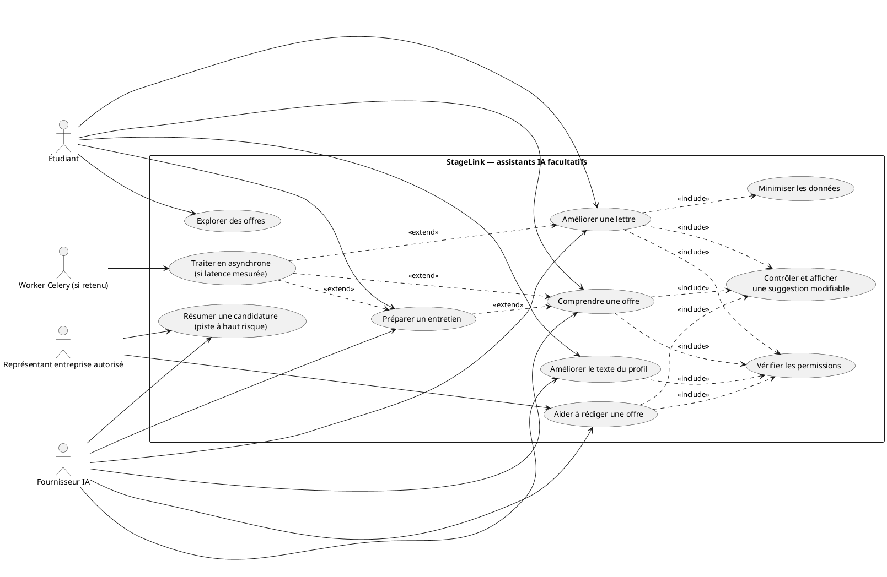

# Dossier de conception — Intégration progressive de l'IA dans StageLink

**Statut : étude seulement.** Aucune fonctionnalité IA, dépendance, clé fournisseur, tâche, endpoint ou donnée nouvelle n'est développée dans cette mission. Tous les cas d'usage ci-dessous sont des propositions à arbitrer.

## 1. Vision fonctionnelle

Rendre certaines tâches de préparation de candidature plus faciles tout en laissant l'étudiant auteur et décideur. Une capacité IA est facultative, explicable comme assistance automatisée, vérifiable et modifiable. Sans fournisseur, le parcours normal StageLink doit fonctionner. L'IA ne prend aucune décision d'admission, de classement ou d'envoi de candidature.

La première expérimentation recommandée est une reformulation à la demande d'un brouillon de lettre pour une offre choisie, avec faits sources explicitement sélectionnés par l'étudiant. Ce n'est qu'une recommandation de séquençage, pas une approbation fonctionnelle.

## 2. Contexte et données réellement présentes

Le code actuel fournit des objets qui pourraient nourrir des cas d'usage, sans les envoyer actuellement à un fournisseur :

- `StudentProfile` : domaine d'étude, niveau, compétences JSON, description, CV (fichier PDF contrôlé, limite configurée 20 Mo).
- `Application` : lettre de motivation et candidature associée à une offre/étudiant.
- `InternshipOffer` : titre, description, compétences attendues, niveau d'étude, et données d'entreprise.
- Profils utilisateur : identité et coordonnées selon le modèle d'authentification.

La présence de ces données dans la base n'autorise pas leur envoi à un modèle externe. Préférer les champs de l'offre publiée et des éléments de texte choisis dans l'interface. Exclure par défaut CV, coordonnées, email, identifiants de candidature et données d'autres utilisateurs.

## 3. Catalogue de cas d'utilisation candidats

Les données et règles ci-dessous sont minimales proposées. Les préconditions d'accès à une offre/candidature doivent suivre les permissions Django déjà applicables à chaque ressource. Toute persistance proposée dépend d'une validation produit et confidentialité.

### UC-A — Améliorer une lettre de motivation

- **Problème/acteur/valeur :** l'étudiant veut clarifier ou adapter son propre brouillon ; obtient une suggestion éditoriale contextualisée.
- **Données :** brouillon explicitement sélectionné, consigne de ton/longueur choisie, extraits pertinents de l'offre ; faits de profil seulement si l'étudiant les coche et les confirme.
- **Préconditions :** étudiant authentifié, offre accessible, brouillon non vide, information de confidentialité/consentement validée, quotas disponibles.
- **Déclencheur :** action explicite « Proposer une amélioration ».
- **Nominal :** vérification serveur de l'accès → minimisation/masquage → génération → contrôle de format et limites → affichage différencié comme suggestion → l'étudiant compare, modifie, copie ou rejette.
- **Alternatives :** brouillon trop long/vide → erreur locale ; réseau/fournisseur indisponible → le brouillon reste accessible ; sortie invalide ou contenant un fait non fourni → rejet/avertissement, aucune application automatique.
- **Postconditions :** aucun envoi de candidature ; aucune modification silencieuse de `Application.cover_letter` ; seule une action explicite enregistre le texte choisi.
- **Risques/contrôle humain :** hallucination de faits, ton inadéquat, fuite de données ; afficher le texte source et proposer l'édition complète avant toute sauvegarde.
- **Coût :** tokens d'entrée du brouillon+offre et tokens de sortie ; frais de relance si réessayé. Les tailles et tarifs doivent être mesurés/choisis.

### UC-B — Comprendre une offre de stage

- **Problème/acteur/valeur :** l'étudiant veut repérer responsabilités, compétences et critères dans une annonce longue.
- **Données :** description et champs de l'offre choisie, sans CV ni candidature.
- **Préconditions :** utilisateur autorisé à consulter l'offre ; offre textuelle disponible ; limites d'entrée appliquées.
- **Déclencheur :** clic explicite « Résumer / expliquer cette offre ».
- **Nominal :** StageLink envoie les seuls champs de l'offre à l'assistant → présente un résumé structuré avec références aux passages sources → l'étudiant ouvre/compare le texte original.
- **Alternatives :** offre vide ou formatée avec texte hostile/consignes injectées → refus ou extraction uniquement ; offre trop longue → découpe contrôlée ou aide sans IA ; indisponibilité → annonce originale reste lisible.
- **Postconditions :** aucune donnée d'offre n'est modifiée ; le résumé n'est pas présenté comme une décision d'éligibilité.
- **Risques/contrôle :** omission de critères, traduction erronée, prompt injection dans le contenu ; citations de passages et avertissement de vérifier l'annonce source.
- **Coût :** taille du texte de l'offre par génération ; cache de résultats publics possible seulement après examen fraîcheur/confidentialité et coût de cache.

### UC-C — Préparer un entretien

- **Problème/acteur/valeur :** l'étudiant souhaite s'entraîner avec des questions adaptées au rôle.
- **Données :** offre choisie et thème de préparation ; réponse de l'étudiant si simulation interactive.
- **Préconditions :** offre accessible ; l'utilisateur déclenche explicitement le mode entraînement.
- **Déclencheur :** « M'entraîner à l'entretien ».
- **Nominal :** génération d'une question à la fois → l'étudiant répond → retour formatif, relié à des attentes explicites de l'offre → l'étudiant décide de continuer/arrêter.
- **Alternatives :** question inappropriée, réponse contenant des informations sensibles, panne ; arrêter, supprimer le contenu local, montrer conseil générique.
- **Postconditions :** aucune évaluation ou note d'employabilité persistée ; aucune réponse envoyée à une entreprise.
- **Risques/contrôle :** conseils biaisés, anxiété, faux conseils métier ; préciser que c'est un entraînement et demander la vérification.
- **Coût :** plusieurs appels par session et historique de dialogue potentiellement long ; plafond de tours et contrôle du contexte.

### UC-D — Améliorer la présentation du profil étudiant

- **Problème/acteur/valeur :** l'étudiant veut reformuler une description ou des compétences qu'il a déjà saisies.
- **Données :** champ choisi, faits du profil sélectionnés par l'étudiant ; pas le CV complet.
- **Préconditions :** authentification et permission de modifier son profil ; déclaration de l'origine des faits.
- **Déclencheur :** choix explicite « Améliorer ce texte ».
- **Nominal :** produire une proposition de formulation à partir des faits source → afficher côte à côte → l'étudiant modifie et choisit de remplacer ou non.
- **Alternatives :** champ vide ou ne contenant aucun fait → demander à l'étudiant d'ajouter son information ; ne jamais remplir avec des accomplissements génériques présentés comme vrais.
- **Postconditions :** pas de sauvegarde sans action confirmée de l'étudiant.
- **Risques/contrôle :** amplification d'informations personnelles, inventaire de compétences ; revue ligne par ligne par l'étudiant.
- **Coût :** faible à moyen par champ ; limiter les appels par session.

### UC-E — Aider une entreprise à rédiger une offre

- **Problème/acteur/valeur :** une entreprise veut rendre une offre plus claire et complète.
- **Données :** brouillon saisi par un représentant autorisé, informations métier qu'il coche, modèle de champs de l'offre ; pas de candidature.
- **Préconditions :** rôle et droit de créer/modifier une offre vérifiés ; contenu non publié ou explicitement sélectionné.
- **Déclencheur :** « Aider à rédiger cette offre ».
- **Nominal :** proposer une reformulation structurée → signaler les champs inconnus comme questions → représentant corrige et approuve → sauvegarde uniquement par le flux normal d'offre.
- **Alternatives :** champs obligatoires absents → question, jamais invention de salaire/lieu/conditions ; panne → éditeur manuel disponible.
- **Postconditions :** aucune publication automatique et aucune modification non confirmée.
- **Risques/contrôle :** conditions de stage inventées, langage discriminatoire, demande interdite ; contrôle humain et validations habituelles du formulaire restent obligatoires.
- **Coût :** longueur du brouillon et nombre d'itérations.

### UC-F — Explorer des offres selon les préférences de l'étudiant

- **Problème/acteur/valeur :** l'étudiant veut découvrir des offres pertinentes parmi les offres autorisées.
- **Données :** préférences facultatives choisies (domaine, localisation, compétences déclarées), champs non sensibles des offres ; idéalement calcul local et filtres explicables avant d'appeler un modèle.
- **Préconditions :** filtres/visibilité d'offre définis par les règles StageLink ; consentement à utiliser les préférences.
- **Déclencheur :** demande explicite de suggestions.
- **Nominal :** requête ORM des offres visibles → filtre/réordonne selon critères choisis → affiche les raisons et les filtres → utilisateur ouvre une offre.
- **Alternatives :** aucune correspondance ou panne → filtres et liste habituels inchangés.
- **Postconditions :** aucune candidature ni décision de rejet automatique ; possibilité d'effacer les préférences.
- **Risques/contrôle :** bulle de recommandation, données incomplètes, discrimination ; critères visibles, tri non exclusif et option de désactivation.
- **Coût :** scoring local potentiellement sans coût externe ; génération d'explications par offre multiplierait les tokens et doit être évitée au départ.

### UC-G — Assistance à la lecture de candidatures (piste à haut risque, ne pas piloter au départ)

- **Problème/acteur/valeur :** les représentants d'entreprise veulent parcourir plus rapidement les candidatures reçues.
- **Données possibles :** candidatures, lettres, CV et identifiants, donc données personnelles à risque élevé.
- **Préconditions à définir :** droits de l'entreprise sur chaque candidature, information des candidats, but limité, politique de conservation, contrôle de biais et revue juridique/confidentialité.
- **Déclencheur potentiel :** un représentant autorisé demande un résumé d'une candidature individuellement.
- **Nominal proposé :** résumé factuel avec citations sur les éléments déclarés → représentant ouvre la source et juge lui-même.
- **Alternatives :** donnée manquante → mention « non indiqué », jamais inférence ; fournisseur indisponible → dossier consultable normalement.
- **Postconditions :** aucune note, présélection, classement, recommandation de rejet ou décision automatique ; résultat non versé au dossier par défaut.
- **Risques/contrôle :** biais et discrimination, profils sensibles, fuite de CV, faux résumé ; accès humain explicite, aucune décision automatisée et audit indépendant avant même un pilote.
- **Coût :** CV long, extraction documentaire/OCR, appels élevés et stockage. Exclu de la feuille de route initiale recommandée.

## 4. Relations fonctionnelles et frontière UML

Système étudié : **StageLink — assistants IA facultatifs**. Acteurs primaires : étudiant, représentant d'entreprise autorisé. Acteurs secondaires : fournisseur IA externe, worker Celery si l'asynchronisme est retenu. Le navigateur et le serveur Django sont des composants internes, pas des acteurs. Le système externe ne reçoit que les données minimales autorisées.

Relations proposées : UC-A inclut vérifier l'accès, minimiser les données, contrôler le résultat et présenter une suggestion modifiable. UC-B inclut contrôler l'accès et pointer vers le texte source. UC-C peut étendre UC-B si l'étudiant choisit ensuite une simulation. UC-D inclut autorisation de modification de profil. UC-E inclut vérifier l'autorisation d'entreprise et garder le flux d'enregistrement habituel. Une tâche asynchrone étend un use case seulement si les mesures de latence montrent qu'un appel SSR synchrone est insuffisant. UC-G est un cas d'étude distinct, pas une inclusion obligatoire ni un lancement accepté.

### PlantUML : vue de cas d'utilisation proposée

UC-G est intentionnellement omis du diagramme opérationnel car sa mise en œuvre n'est pas recommandée sans arbitrage de risque séparé. Le diagramme peut être scindé par acteur pour une version UML de validation.

## 5. Architecture technique simple et remplaçable

Flux SSR proposé : template Django → vue avec permission et validation de taille → petit service de cas d'usage (contexte autorisé, prompt, validation de résultat) → interface fournisseur minimale (par exemple `generate(request, timeout)`) → adaptateur fournisseur configuré côté serveur. La logique métier ne manipule pas les classes SDK du fournisseur. Au départ, un seul adaptateur réel suffit ; l'abstraction doit permettre un remplacement sans introduire une matrice de providers.

Réponse initiale : usage synchrone seulement si le temps de réponse cible est mesuré et compatible avec l'UX. Timeout court et message de repli. Si le test montre une latence trop longue ou une opération documentaire, Celery est pertinent : enregistrer un identifiant d'opération et un état, soumettre une tâche idempotente, puis consulter l'état avec une vue SSR minimale. Délais/soft time limit, nombre maximal de tentatives, file dédiée et limites de concurrence sont fixés par mesure et budget. Les erreurs fonctionnelles, refus du modèle et erreurs 4xx ne sont pas retentés ; erreur réseau/5xx éventuellement une seule reprise avec délai, si le coût est accepté.

Ne pas ajouter de `AIRequest`/table d'historique avant de connaître le besoin de conservation. Si un suivi est nécessaire : stocker le propriétaire, feature, provider/model, état, horodatages, unités tokens/coût estimées, correlation ID et code erreur expurgé. Ne pas conserver prompts, CV ou sorties dans les logs. Les brouillons choisis restent dans leur flux existant si l'utilisateur l'approuve. Idempotency key par demande et quotas par utilisateur réduisent doublons et coût.

## 6. Confidentialité, sécurité et qualité des sorties

- **Données étudiants :** traitement local en priorité ; contexte minimum. Pas d'email, téléphone, nom, identifiant, CV complet ni autres candidatures par défaut. Extraction CV serait un cas d'usage distinct, avec validation particulière.
- **Lettres/candidatures :** peuvent contenir des informations sensibles. Informer précisément avant envoi externe ; séparer le texte envoyé et le reste du dossier.
- **Données entreprises :** brouillons non publiés peuvent être confidentiels ; ne pas envoyer de détails internes ou noms de candidats pour des tâches de rédaction.
- **Transport et secrets :** HTTPS fournisseur, clés dans le gestionnaire de secrets/configuration serveur, droits minimaux, rotation et environnement de test sans données réelles.
- **Conservation et entraînement :** durée nulle ou minimale côté StageLink par défaut ; vérifier contractuellement la conservation côté fournisseur et toute réutilisation pour entraînement. Les régions, transferts, sous-traitants et base légale doivent faire l'objet d'un avis confidentialité/juridique adapté avant pilote ; ce dossier ne conclut pas à la conformité légale.
- **Logs :** identifiant opaque de requête, cas d'usage, statut, latence, tokens, coût calculé, catégorie d'erreur ; aucune donnée brute ni payload. Limiter l'accès et durée des métriques.
- **Hallucinations :** instruction de n'utiliser que les faits fournis, marquer les inconnues « non indiqué », demander une précision au lieu de compléter. Les modèles restent capables d'inventer ; contrôler la sortie et demander à l'humain de vérifier chaque suggestion.
- **Action engageante :** aucun envoi candidature, changement de profil/offre, contact entreprise ou décision automatisée sans action humaine explicite. IA ne crée jamais expérience, diplôme, compétence ou certification.
- **Abus :** limites de longueur, débit et coût côté serveur ; protection prompt injection dans annonces/CV, échappement du HTML, pas d'exécution d'outils/URLs arbitraires.
- **Dégradation :** l'éditeur et l'offre restent utilisables si fournisseur/Redis/Celery est indisponible. Pas de retry infini ; message utile et réessai explicite.

## 7. Maîtrise des coûts

Choisir le fournisseur et ses tarifs uniquement après décision et vérification à la date d'achat. Modèle de calcul mensuel :

`appels × (tokens entrée × tarif entrée + tokens sortie × tarif sortie) / unité de facturation + éventuels frais fichiers/stockage`

À titre de dimensionnement de volume uniquement (pas une estimation monétaire) : 1 000 appels de 1 500 tokens entrants/800 sortants consomment environ 1,5 M tokens entrée et 0,8 M sortie ; multiplier par dix pour 10 000 appels. Définir budget maximum mensuel, quota par compte, taille/tours maximum, modèle de coût faible pour tâche simple, plafond de sortie et alertes à seuils. Mesurer tokens réels et taux d'erreur en pilote. Les reprises doivent être rares, bornées et visibles dans le coût. Pas de traitement CV en lot ou scoring massif dans un premier pilote.

## 8. Exceptions et résultats

| Situation | Réponse attendue |
|---|---|
| Non connecté / pas d'accès à l'offre ou au profil | Refus serveur normal, aucun appel fournisseur. |
| Consentement / feature non activée | Aucun appel ; parcours manuel disponible. |
| Texte vide ou trop long | Validation locale/serveur avant fournisseur. |
| Timeout, erreur réseau, 5xx | État exploitable, brouillon conservé, un retry borné seulement si adapté ; sinon repli manuel. |
| 4xx, quota, paiement/config fournisseur | Pas de retry automatique ; erreur non sensible, alertes opérateur expurgées. |
| Sortie mal formée ou dangereuse | Ne pas l'afficher/exécuter, conserver l'original, journaliser catégorie sans texte. |
| Hallucination malgré les contrôles | L'étudiant rejette/édite ; signalement éventuel à définir. Ne jamais faire passer la sortie pour un fait validé. |
| Tâche asynchrone arrêtée | Lease/expiration et statut échoué récupérable, reprise unique bornée ; jamais de blocage de la candidature. |

## 9. Feuille de route proposée

1. **Décisions préalable :** sélectionner un cas d'usage, données autorisées, utilisateur cible, consentement, conservation, contrat fournisseur, quota/budget et mesures de qualité.
2. **Étude de risque :** revue vie privée/sécurité et threat model incluant injection, fuite et mauvaise attribution de faits.
3. **Prototype non connecté** sur jeu de données synthétique : tester prompts, format de suggestion, garde-fous et qualité.
4. **Pilote facultatif** sur UC-A seulement, texte de brouillon sélectionné par l'utilisateur, pas de CV, sauvegarde manuelle, budget strict et télémétrie sans contenu.
5. **Évaluation** : fidélité aux faits, taux de rejet/édition, latence, erreurs, tokens/coût, satisfaction et incidents confidentialité ; critères d'arrêt décidés avant pilote.
6. **Extension éventuelle** à comprendre une offre puis préparation d'entretien ; profil étudiant ensuite. Offre employeur uniquement après audit de biais éditoriaux. UC-G demeure reporté.

## 10. Décisions obligatoires avant développement

1. Quel cas d'usage pilote et pour quel rôle ? Confirmez ou rejetez UC-A.
2. Quelles sources l'étudiant peut-il choisir : brouillon, offre, compétences de profil, CV ? Proposition minimale : brouillon et offre seulement.
3. Envoyer du texte à un service tiers est-il acceptable ? Quel consentement et quelle information ?
4. Quel fournisseur, région, contrat, réutilisation, durée de conservation et mécanisme de suppression ?
5. Quel budget mensuel, volume, limite par compte, taille et tarif maximal ?
6. Faut-il sync SSR pour le pilote ou Celery ? À décider après benchmark de latence sans données personnelles.
7. L'utilisateur peut-il enregistrer directement une sortie dans `Application.cover_letter` après confirmation, ou seulement copier ?
8. Quels critères de qualité/fidélité et processus pour signaler une invention ?
9. Toute aide à l'entreprise/candidature nécessite une décision distincte ; aucun classement ou décision d'embauche automatique n'est inclus.
